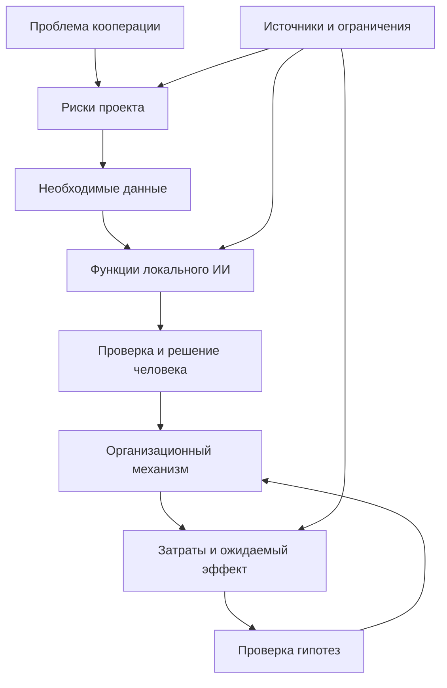

# Карта знаний

Все связи ниже — рабочая логика исследования, а не доказанные причинные зависимости.

| Узел | Ключевой вопрос | Материал | Результат |
|---|---|---|---|
| Проблема | Какой процесс нуждается в улучшении? | [Паспорт](research/thesis-passport.md) | Границы исследования |
| Кооперация и риски | Где возникают отклонения и кто отвечает? | [База знаний](knowledge/domain-map.md) | Рабочая типология рисков |
| Данные | Какие признаки доступны законно? | [Политика данных](data/README.md) | Схема данных |
| ИИ | Где нужен ИИ, а где достаточно правил? | [Концепция](solution/concept.md) | Требования и альтернативы |
| Управление | Кто проверяет сигнал и принимает меры? | [Концепция](solution/concept.md) | Роли и контрольные точки |
| Экономика | Превышает ли эффект полные затраты? | [Модель](economics/model.md) | Сценарии и чувствительность |
| Доказательства | Чем подтверждён каждый вывод? | [Источники](resources/bibliography.md) | Реестр оснований |
| Текст | Где результаты отражены в дипломе? | [План](thesis/outline.md) | Согласованная логика глав |

## Сквозные вопросы
- H1: предложенный механизм может сократить время подготовки риск-обзора без неприемлемого ухудшения качества.
- H2: экономическая целесообразность зависит от масштаба использования, стоимости инфраструктуры и затрат проверки ответов.
- H3: эффект следует сравнивать не только с ручной работой, но и с правилами/обычным поиском без LLM.

Это проверяемые гипотезы. Доказательств их выполнения на предприятиях пока нет.
